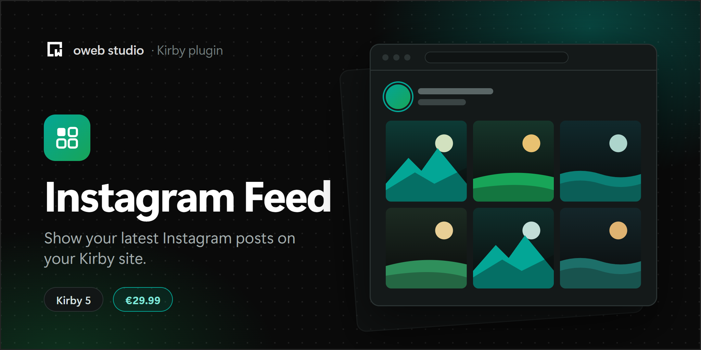

# Kirby Instagram Feed

[](https://owebstudio.lemonsqueezy.com/checkout/buy/29afd8d3-78d4-4cd5-a19b-a13c3d3b5e1b)

Instagram feed on your website for Kirby 5 and 6 (PHP 8.2 to 8.5, Kirby 6 needs PHP 8.3 or newer). For Kirby 3 and 4,
use [version 1.4.0](https://github.com/owebstudio/kirby-instagram-feed/releases/tag/1.4.0).

⚠️ Client must have a business professional/creator account for this to work

## Instagram API

This plugin is powered by
the [Instagram API with Instagram Login](https://developers.facebook.com/docs/instagram-platform/instagram-api-with-instagram-login).

### Rate Limits

There is an Instagram API
request
limit ([Instagram API rate limits](https://developers.facebook.com/docs/graph-api/overview/rate-limiting/#platform-rate-limits))
. Don't worry! The plugin caches it periodically for the time
you set from config.

If Kirby's [pages cache](https://getkirby.com/docs/guide/cache) is active, pages that show the feed are cached until the
feed expires, so they always show a fresh feed.

If the Instagram API fails, the plugin keeps showing the last feed and tries again after an hour.

### Expire Token

Instagram access token expires after 2 months (60 days) by default. The plugin automatically renews the token one week
before it expires, so you don't need to do anything. On a live site this needs a license key (see [License](#license)).

The renewed token is kept in `site/config/.instagram-feed-token`. Keep this file when you deploy your site. When you
set a new token in your config, the plugin uses it and forgets the renewed one.

## Installation

1. Download the latest release
2. Unzip downloaded file
3. Copy/paste unzipped folder in your `/site/plugins` folder

## Usage

You can use sample basic snippet of plugin:

```php
<?php snippet('instagram-feed') ?>
```

The snippet shows images and videos, and the images and videos of albums. Images are loaded lazily and use the caption
as `alt` text. You can limit the number of posts and choose the types of posts (`image`, `video` and `album`):

```php
<?php snippet('instagram-feed', ['limit' => 6, 'types' => ['image', 'album']]) ?>
```

Each image or video is rendered by the `instagram-feed/media` snippet. To change its markup, copy
`snippets/instagram-feed/media.php` of the plugin to `site/snippets/instagram-feed/media.php`.

If you want to customize it, you can look the example usage below:

```php
<?php foreach (site()->instagramFeed() as $feed): ?>
    <?php if ($feed->is_image() === true && $src = $feed->media_url()): ?>
        <a href="<?= esc($feed->permalink() ?? '') ?>" target="_blank" rel="noopener">
            " alt="<?= esc($feed->caption() ?? '') ?>" loading="lazy">
        </a>
    <?php endif ?>
<?php endforeach ?>
```

### Available `$feed` methods

- $feed->id()
- $feed->caption()
- $feed->is_album()
- $feed->is_image()
- $feed->is_video()
- $feed->media() (The stored file as Kirby [asset](https://getkirby.com/docs/reference/objects/filesystem/asset), only
  available with the `store` option)
- $feed->media_type() (The Media's type. Can be `IMAGE`, `VIDEO` or `CAROUSEL_ALBUM`)
- $feed->media_url() (Can be `null`. Instagram omits it for albums without a
  cover and for media flagged for a copyright violation, so always check it
  before rendering)
- $feed->permalink()
- $feed->thumbnail() (The stored thumbnail of a video as Kirby asset, only available with the `store` option)
- $feed->thumbnail_url()
- $feed->timestamp()
- $feed->username()
- $feed->children() (Only available for the `CAROUSEL_ALBUM` media type)

Also `site()->instagramFeed()` and all items (`$feed`) in it are collection objects and have all collection methods.

The values come from Instagram, so escape them in your HTML, e.g. with `esc($value)`.

### Showing album feeds

If the feed item is an album media type, it does not have a media element/url. Album media type is a collection of
multiple media. For this you should call the `$feed->children()` method. This method returns a media collection. Here is
an example of usage:

```php
<?php if ($feed->is_album() === true && $children = $feed->children()): ?>
    <?php foreach ($children as $child): ?>
        <?php if ($child->is_image() === true && $src = $child->media_url()): ?>
            <a href="<?= esc($child->permalink() ?? '') ?>" target="_blank" rel="noopener">
                " alt="<?= esc($feed->caption() ?? '') ?>" loading="lazy">
            </a>
        <?php elseif ($child->is_video() === true && $src = $child->media_url()): ?>
            <a href="<?= esc($child->permalink() ?? '') ?>" target="_blank" rel="noopener">
                <video width="100%" height="100%" autoplay preload muted loop playsinline>
                    <source src="<?= esc($src) ?>" type="video/mp4">
                </video>
            </a>
        <?php endif ?>
    <?php endforeach ?>
<?php endif ?>
```

### Serving images and videos from your server

With the `store` option, the plugin downloads the images and videos of the feed to the `media/instagram-feed` folder,
and the snippet only uses these files. Visitors' browsers then don't load anything from Instagram, which helps with
privacy laws like the GDPR. Files of posts that are no longer in the feed are deleted.

In your own markup, use `$feed->media()` and `$feed->thumbnail()` instead of the URLs. Both are Kirby assets, so you can
also create thumbnails of images:

```php
<?php if ($image = $feed->media()): ?>
    resize(600)->url() ?>" alt="<?= esc($feed->caption() ?? '') ?>" loading="lazy">
<?php endif ?>
```

### Refreshing the feed with a cron job

The feed is fetched when a page shows it and the cache has expired. To keep the feed fresh without making a visitor
wait for Instagram, refresh it regularly with the [Kirby CLI](https://github.com/getkirby/cli), e.g. every few hours
with a cron job:

```bash
kirby instagram-feed:refresh
```

## Options

The default values of the package are:

| Option      | Type    | Default | Description                                                                                                                               |
|:------------|:--------|:--------|:------------------------------------------------------------------------------------------------------------------------------------------|
| accessToken | string  | null    | Access token for the Instagram API with Instagram Login.                                                                                  |
| cache       | boolean | true    | Enable/disable caching the feed. Highly recommended that the cache be enabled to avoid exceeding api request limit.                       |
| store       | boolean | false   | Enable/disable storing images and videos on your server (see [above](#serving-images-and-videos-from-your-server)).                       |
| debug       | boolean | false   | Enable/disable debugging for this plugin.                                                                                                 |
| expire      | int     | 1440    | Sets how long the feed items are cached as minutes. Default is one day.                                                                   |
| limit       | int     | 20      | Sets how many feed items are fetch from API.                                                                                              |

All the values can be updated in the `config.php` file and prefixed with `owebstudio.instagram-feed.`

## Sample options

```php
<?php

// /site/config/config.php
return [
    'owebstudio.instagram-feed' => [
        'accessToken' => 'INSTAGRAM_ACCESS_TOKEN',
        'cache' => true,
        'store' => true,
        'debug' => false,
        'expire' => 180, // 3 hours
        'limit' => 10 // fetch limit 
    ]
];
```

## Creating Instagram token

Follow the steps below to create a new Instagram token. Remember, client must have a business professional/creator account for this to work

1. Login to https://developers.facebook.com/
2. Create a new App
3. Make an App name
4. Choose "Other" for use case
5. Choose "Business" for app type
6. Confirm "Create App"
7. Add Instagram product to your App
8. Add client Instagram account to the Instagram API
9. Generate a new token
10. Add this token to the site/config.php or other config environment file
11. Delete the `site/cache` folder, so that the feed is fetched with the new token

## License

Instagram Feed is a commercial plugin. It is free to use on your local computer and on staging sites. A live site needs
a license key: [buy one](https://owebstudio.lemonsqueezy.com/checkout/buy/29afd8d3-78d4-4cd5-a19b-a13c3d3b5e1b) and
activate it in the Panel's System view (Kirby 5 and newer) by clicking the license status of the plugin.

Without a license key, the plugin does not renew the Instagram access token on a live site. The feed keeps working until
the token expires (60 days after it was created or last renewed). After that, the snippet renders nothing.

[oweb studio Commercial License](LICENSE.md). Versions released under the MIT license stay MIT. The current license is
available at https://github.com/owebstudio/.github/blob/main/LICENSE.md.
